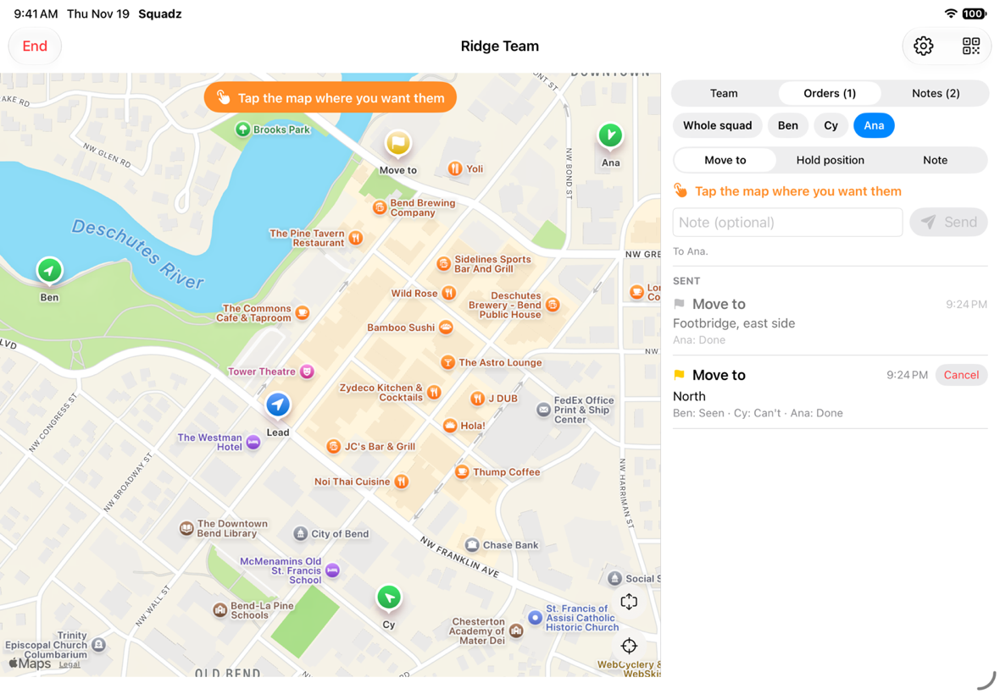
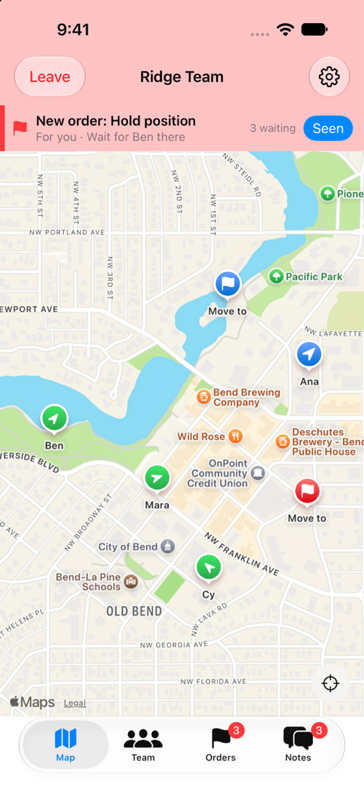
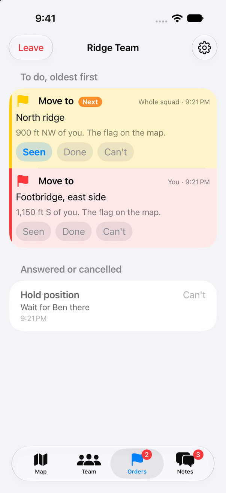
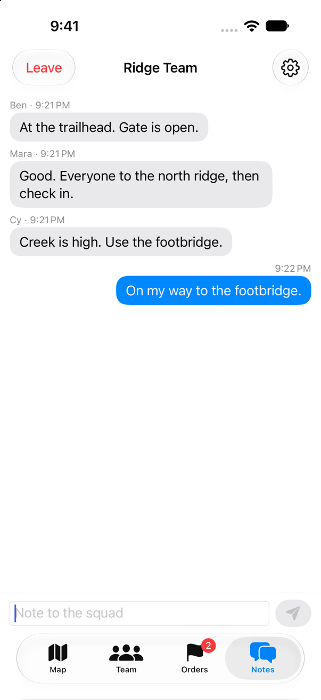
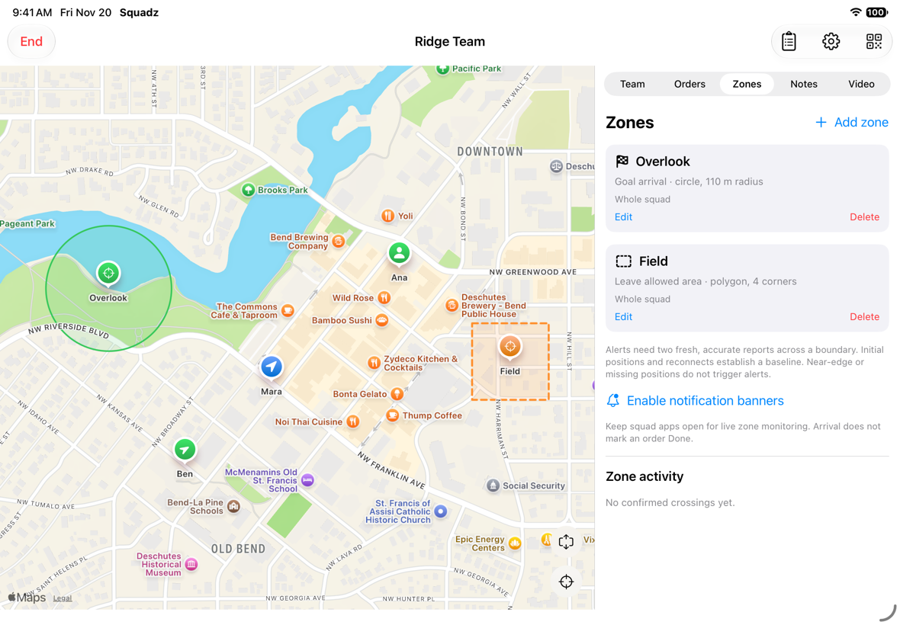

# Squadz

The home of any squad: a core that every app can use, with missions as add-ons.



A squad is a leader's device and its members' phones. Members share positions, get orders, send notes and can call check fire; the leader's device runs the squad and decides everything. What the squad is out doing (a round of golf, a search, a ski tour) is a **mission**, added on top without changing the core.

The plan is [issue #2](https://github.com/zacharyelston/squadz/issues/2). This is steps V1, V2, V2b, V3 and V4 of it, and the Squadz app for iPhone and iPad on top. The original Squadz (a Rust server and a web page) is the tag `v1`.

| Part | Where | Status |
| --- | --- | --- |
| **SquadKit**: the squad protocol and the leader's state. Join, roster, positions, orders, notes, files, check fire, holds, missions. No network code | [`swift/Sources/SquadKit`](swift/Sources/SquadKit) | Built and tested |
| **SquadLink**: SquadKit over the local network (Bonjour, TLS keyed per member), and through a relay | [`swift/Sources/SquadLink`](swift/Sources/SquadLink) | Built; tested on one Mac's loopback only |
| **CoreGeo**: GPS points and small-area geometry | [`swift/Sources/CoreGeo`](swift/Sources/CoreGeo) | Built |
| The wire format, for implementations in other languages | [`docs/WIRE.md`](docs/WIRE.md), [`testdata/wire`](testdata/wire) | Written, with vectors |
| Join by QR, member credentials, the leader's identity key | SquadKit (`Credentials.swift`, `Invite.swift`), SquadLink, [`testdata/join`](testdata/join) | Built and tested. The app shows and scans the code; scanning was tried on a real iPhone |
| **Squadz for iPhone and iPad**: lead or join a squad, see everyone on a map, send orders, share notes | [`ios/`](ios), [`docs/APP.md`](docs/APP.md) | Run on a real iPhone and iPad on one Wi-Fi network, and in the simulator. Not yet tried through the relay on real devices, or over cellular |
| **Relay**: carries a squad's links over the internet. Rust | [`relay/`](relay), [`docs/RELAY.md`](docs/RELAY.md) | Built and tested on one Mac and on a second machine on the same network. Not yet run on the internet. It can't read what it carries: links through it are sealed between the two devices. [`deploy/openmanet`](deploy/openmanet) puts it on a mesh node; not yet tried on one |

SquadKit and SquadLink come from GroupKit and GroupLink in [BackyardBallistics](https://github.com/zacharyelston/BackyardBallistics), with golf taken out. BackyardBallistics does not use this package yet; [`docs/BACKYARDBALLISTICS.md`](docs/BACKYARDBALLISTICS.md) lists what it has to change to do so.

## The app

One device starts a squad and leads it; the others scan its invite code, confirm, and join. The leader's device *is* the squad: the others connect straight to it over Wi-Fi or a mesh, and there is no server. A squad started with a relay's address can also be reached over the internet ([`docs/RELAY.md`](docs/RELAY.md)).

| A member's map | Orders, as a queue | Notes, as a chat |
| --- | --- | --- |
|  |  |  |

- **Everyone on a map.** Each pin is an arrow that points the way that device is pointing. The leader sets how often the squad's devices report, from every 2 seconds to every minute.
- **Orders.** The leader sends one member, several, or the whole squad somewhere with a tap on the map, tells them to hold, or sends a note. Each answers Seen, Done or Can't, and the leader sees every answer. The leader can take an order back.
- **Field notes.** A chat the whole squad reads and writes.
- **Leaving and removing.** Either one tells the rest of the squad.
- **Video, a first cut.** A member can stream their camera to the leader's device: one at a time, and only on a tap. The leader can record a clip or snap a still, and the squad is shown when they do. [`docs/VIDEO.md`](docs/VIDEO.md) says how it works and what it doesn't do yet.
- **A mission log.** The leader's device keeps what happened in each squad, in time order: positions, orders and answers, notes, who came and went, streams, and the clips and stills kept from them. It can be reviewed in the app and exported whole. [`docs/MISSION_LOG.md`](docs/MISSION_LOG.md).

[`docs/APP.md`](docs/APP.md) walks through every screen.

Xcode 16 or later and [XcodeGen](https://github.com/yonaskolb/XcodeGen):

```bash
cd ios && xcodegen generate && open Squadz.xcodeproj
```

```bash
cd ios && xcodebuild -project Squadz.xcodeproj -scheme Squadz -destination 'platform=iOS Simulator,name=iPhone 18 Pro' test
```

A simulator has no camera. To join from one, open the invite as a link (the text of the QR code); the app still asks before joining:

```bash
xcrun simctl openurl booted 'squadz://join?…'
```

To run on a phone, pick your signing team in Xcode. It is not kept in the project file.

Known limits:

- Positions are shared only while the app is open and in front.
- Orders and notes on screen are kept only while the leader's app is running. If it is closed and opened again, the squad and its members come back; what was sent and said does not, though the mission log still has it.
- The leader's phone has to stay on, in reach and with the app open. If it goes, the squad stops updating until it is back; nobody else can take over yet.
- Without a relay, local network only: the same Wi-Fi, or a mesh that passes Bonjour (mDNS) between its nodes. With one, the relay sees which devices are connected and how much they send, not what; and a phone that joined before the squad had a relay needs a new invite to use it.
- The map is Apple's, which needs the internet for places the phone hasn't looked at before. Pins and the member list don't.
- A phone is in one squad at a time. Leaving means asking for a new invite to come back.
- Joining is by QR code or invite link. The typed code is in SquadKit but has no screen.
- No photos yet: notes are text, and the core's capture order has no screen.

## Theater on a Mac

[Theater](theater/README.md) watches one or more squads as a read-only observer and serves separate Map, Team, Orders, Notes, Zones, Video and Wall views for browser windows on multiple monitors. The leader can see and remove observers. It defaults to loopback; explicit LAN access uses a view passcode. Maps use optional local XYZ tiles, with a labeled coordinate grid when none are configured. Video remains leader-only.

```sh
swift run --package-path theater squadz-theater --demo
```

## Using it

```swift
import SquadKit
import SquadLink

// The leader's device. Its keys come from the Keychain, the rest from where the app saves it.
let keychain = SquadKeychain(service: "com.example.squadz.squads")
var squad = SquadCore(squad: Squad(name: "Red"), mission: NoMission())
try keychain.save(squad.keys, for: squad.squadID)
let host = try SquadLinkHost(name: "Red", keys: [], txt: [SquadService.Key.tag: squad.squadID.tag])
func send(_ out: [Outgoing]) {
    host.send(out)
    host.setKeys(squad.linkKeys(now: Date()))   // who may connect may have changed
}
host.onOpened = { peer, identity in squad.linkOpened(peer, identity: identity) }
host.onMessage = { message, peer in send(squad.handle(message, from: peer, now: Date())) }
host.onPeerClosed = { send(squad.peerClosed($0)) }
host.start()

// Open joining and show this as a QR code.
let link = squad.openJoining(now: Date(), by: "Leader's iPad").url(scheme: SquadService.squadz.scheme)
host.setKeys(squad.linkKeys(now: Date()))

// A member's phone: scan, show "Join Red led by Leader's iPad?", and only on a tap:
let invite = try SquadInvite(url: scanned, scheme: SquadService.squadz.scheme)
let enroller = SquadEnroller(invite: invite, name: "Ana", device: deviceID)
enroller.onDone = { result in
    guard case let .success(credential) = result else { return /* say why */ }
    try? keychain.save(credential)
    let client = SquadLinkClient(credential: credential, name: "Ana", device: deviceID)
    client.onMessage = { message in /* .welcome, .status, .order, ... */ }
    client.start()
}
enroller.start()
client.send(.position(MemberPosition(at: here, accuracy: 5, time: Date())))
```

A mission is a type that conforms to `Mission`; see [`Mission.swift`](swift/Sources/SquadKit/Mission.swift) and the `RallyMission` in the tests.

## Rules that don't change

- The leader's device is the authority. Nothing else runs a squad or decides anything.
- Holds only add. The core unions its holds with the mission's; nothing a mission or a message does can lift a core hold. A fuzz test pins it.
- A message's sender is the link it arrived on, never a field in the message.
- No secrets, hostnames, team IDs or account details in the source.

## Tests

```bash
cd relay && cargo build && cargo test
```

```bash
cd swift && swift test
```

```bash
cd ios && xcodegen generate && xcodebuild -project Squadz.xcodeproj -scheme Squadz -destination 'platform=iOS Simulator,name=iPhone 18 Pro' test
```

The Swift tests that go through a relay start the one just built, and are skipped if it isn't there. As of this writing: 13 relay tests, 83 package tests and 11 app tests.

## Shared geometry and zones



The geometry and the zones are part of this repository's Swift package, in [`swift/`](swift): CoreGeo (GPS points and small-area geometry), ZoneKit (circles, polygons and confirmed boundary crossings), and ZoneMapKit (drawing them on a map). Nothing here needs another repository to build. An app that wants them, SpudGunGolf included, depends on this package and takes those products.

The commander can add, label, edit and delete circles or polygons in **Zones**, choose which members they cover, and select goal-arrival or allowed-area-departure alerts. Zone definitions and the latest 50 events are saved with the squad. Enable notification banners from Zones for system alerts. Live monitoring currently requires the squad apps to be open and connected; missing GPS or a disconnected member does not imply a departure.
