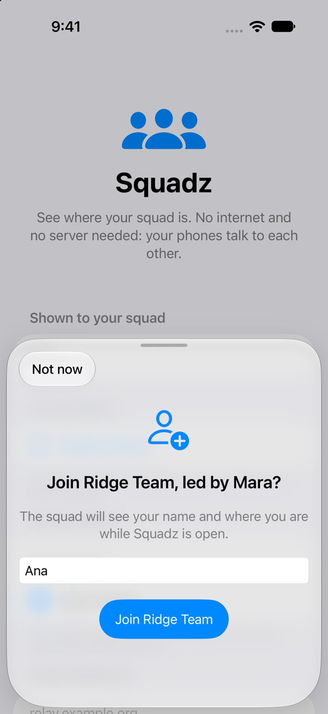
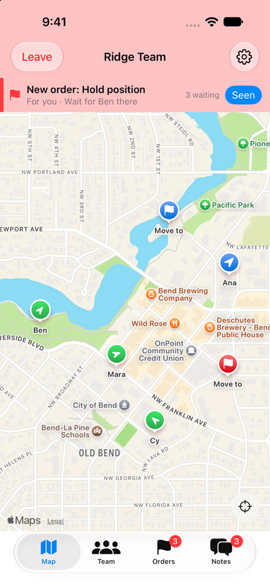
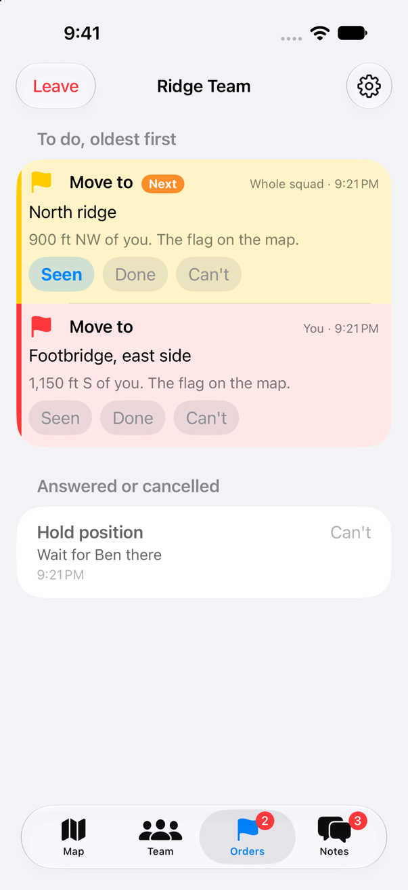
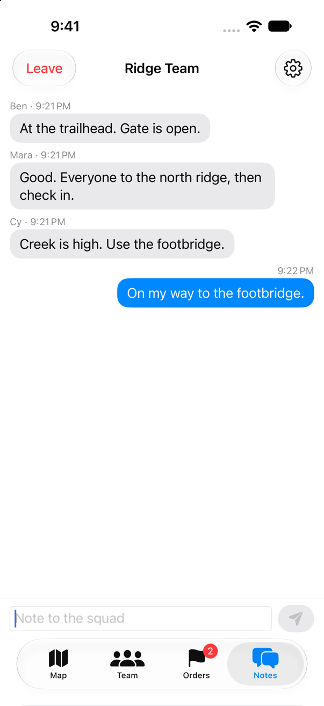
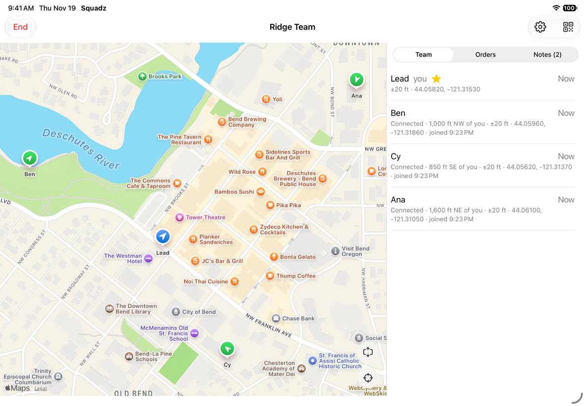
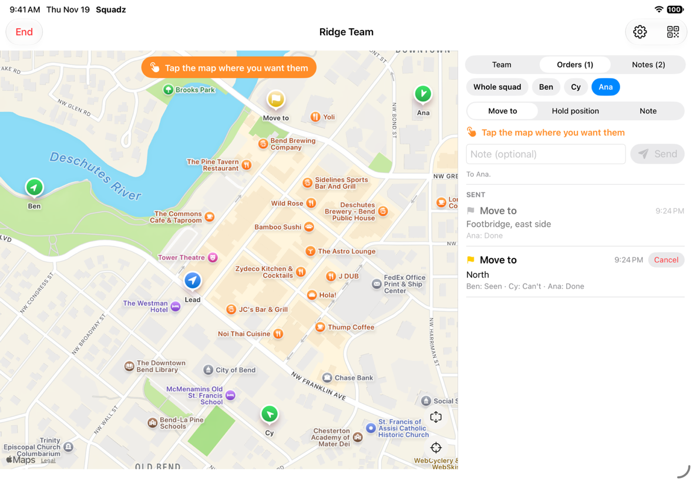
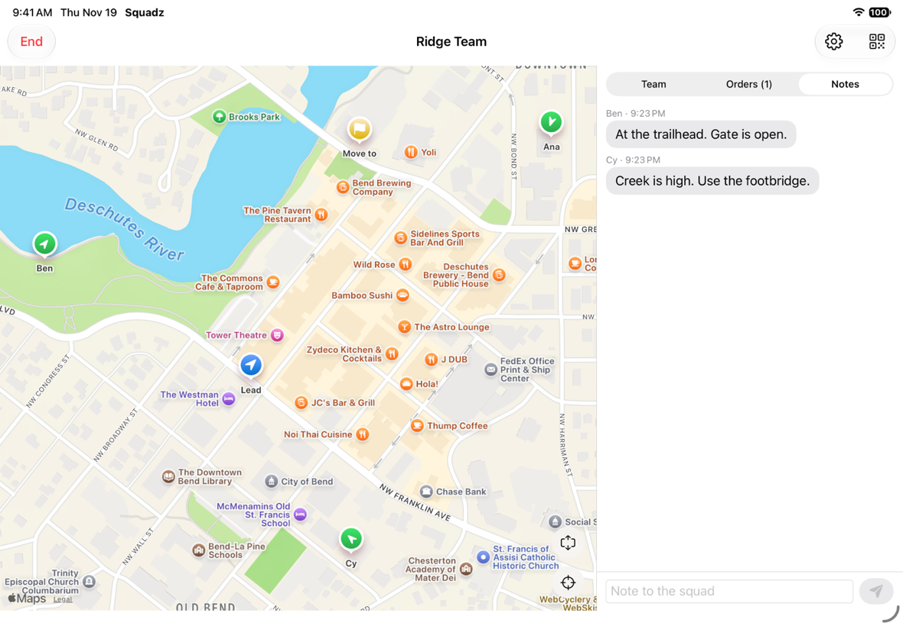

# The Squadz app

What each screen does, on a member's phone and on the leader's device. The app is in [`ios/`](../ios); it runs on iPhone and iPad, and the same build leads or joins.

The screenshots are from the simulator, with made-up people in a made-up squad.

## Joining

The leader opens **Invite** (the QR button) and shows the code. A member taps **Scan an invite**, points the camera at it, and is asked before anything happens.

- The app never joins on a scan alone. It shows who leads the squad and waits for a tap.
- The code works for 15 minutes, or until the leader closes joining.
- Once in, a phone keeps its own key for the squad. It comes back after a restart without a new code.
- The first time, iOS asks whether Squadz may find devices on the local network. Until that is answered the phone reaches nothing, so the join keeps looking for 20 seconds instead of failing at once.

## A member's phone

Four tabs: **Map**, **Team**, **Orders** and **Notes**.

### Map

- The map has the whole screen.
- Every pin is an arrow that points the way that device is pointing. This phone's own arrow follows its compass as it turns; the others move when their next position arrives.
- A new order appears across the top as it arrives, with a **Seen** button, and the phone buzzes. Once it is seen, the line shows the next order to do. Tapping the line opens the Orders tab.
- An order with a place is a flag on the map. When a new flag lands outside the view, the map zooms out to take it in.

### Orders

- Orders still to do are a queue, oldest first, with the first marked **Next**.
- Each has three answers: **Seen**, **Done** and **Can't**. Seen keeps it in the queue; Done and Can't move it to the list underneath.
- An order the leader takes back leaves the queue and shows as cancelled.

Colours, here and on the map's flags:

| Colour | Meaning |
| --- | --- |
| Blue | For the whole squad, not yet seen |
| Red | For you in particular, not yet seen |
| Yellow | Seen |
| Grey | Can't |

### Notes

A chat for the whole squad. What you write is on the right. Someone who joins late or reconnects gets the latest 50 notes. The tab shows how many are unread.

### Team

Each person, how long ago they were last heard from, and a line of details: how far and which way they are from you, how good their fix is, and where they are. The gear button chooses which details show; the choice is this phone's own.

## The leader's device

The map, with a panel beside it on an iPad and under it on a phone. A round button on the map puts the panel away, to give the map the screen.

### Team

The same list a member sees, plus what only the leader's device knows: whether each person's device is connected right now (directly or through the relay) and when they joined. Swipe a name to remove that person; the rest of the squad is told.

### Orders

Everything is on show at once:

1. **Who:** the whole squad, or tap names.
2. **What:** Move to, Hold position, or Note.
3. **Where**, for Move to: tap the map. The place shows as a purple flag until the order is sent.
4. A note, and **Send**.

Under that, what was sent, with each person's answer. **Cancel** takes an open order back. Sending the same people a new Move to cancels their earlier one, so only the latest flag shows.

On the leader's device an order turns yellow once everyone it was for has answered, and grey if they all said can't.

### Notes

The same chat, beside the map.

### Squad settings

The gear button.

- **Show under each member:** which details the team list shows on this device.
- **Position updates**, leader only: how often every device in the squad sends where it is and which way it points, from every 2 seconds to every minute. Each device takes it up as it joins, and again if the leader changes it. Faster uses more battery on every phone.

## Leaving and ending

- **Leave**, on a member's phone: the leader's device takes that phone off the squad and tells everyone else. Coming back needs a new invite.
- **End**, on the leader's device: everyone is disconnected and nothing of the squad is kept.

## What isn't kept

Orders and notes live in the leader's app while it is running. If the leader's app is closed and opened again, the squad and its members come back, and what was sent and said does not.

## What was checked where

- On a real iPhone and iPad on one Wi-Fi network: scanning the code, joining, the map, the compass arrow, leaving, orders and their answers, cancelling, notes, and the update rate.
- In the simulator and in tests: everything above except the compass and the phone's buzz, which a simulator doesn't have.
- Not yet: any of it through the relay between real devices, or over cellular.
