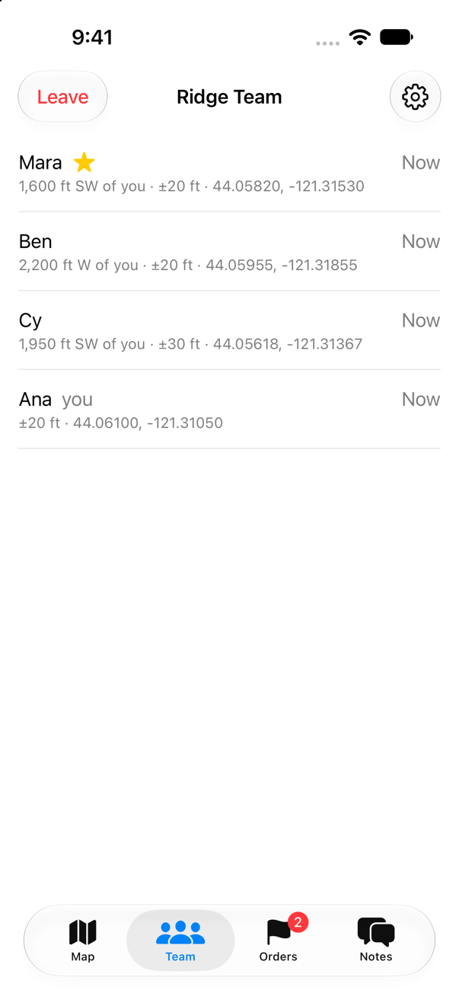

# The Squadz app

What each screen does, on a member's phone and on the leader's device. The app is in [`ios/`](../ios); it runs on iPhone and iPad, and the same build leads or joins.

The screenshots are from the simulator, with made-up people in a made-up squad.

## Joining

The leader opens **Invite** (the QR button) and shows the code. A member taps **Scan an invite**, points the camera at it, and is asked before anything happens.

- The app never joins on a scan alone. It shows who leads the squad and waits for a tap.
- The code works for 15 minutes, or until the leader closes joining.
- Once in, a phone keeps its own key for the squad. It comes back after a restart without a new code.
- The first time, iOS asks whether Squadz may find devices on the local network. Until that is answered the phone reaches nothing, so the join keeps looking for 20 seconds instead of failing at once.

## A member's phone

Five tabs: **Map**, **Team**, **Orders**, **Zones** and **Notes**.

### Map

- The map has the whole screen.
- Every pin is an arrow that points the way that device is pointing. This phone's own arrow follows its compass as it turns; the others move when their next position arrives.
- A new order appears across the top as it arrives, with a **Seen** button, and the phone buzzes. Once it is seen, the line shows the next order to do. Tapping the line opens the Orders tab.
- An order with a place is a flag on the map. When a new flag lands outside the view, the map zooms out to take it in.

### Orders

- Orders still to do are a queue, oldest first, with the first marked **Next**.
- Each has three answers: **Seen**, **Done** and **Can't**. Seen keeps it in the queue; Done and Can't move it to the list underneath.
- An order the leader takes back leaves the queue and shows as cancelled.

Colours, here and on the map's flags:

| Colour | Meaning |
| --- | --- |
| Blue | For the whole squad, not yet seen |
| Red | For you in particular, not yet seen |
| Yellow | Seen |
| Grey | Can't |

### Notes

A chat for the whole squad. What you write is on the right. Someone who joins late or reconnects gets the latest 50 notes. The tab shows how many are unread.

### Team

Each person, how long ago they were last heard from, and a line of details: how far and which way they are from you, how good their fix is, and where they are. The gear button chooses which details show; the choice is this phone's own.

## The leader's device

The map, with a panel beside it on an iPad and under it on a phone. A round button on the map puts the panel away, to give the map the screen.

### Team

The same list a member sees, plus what only the leader's device knows: whether each person's device is connected right now (directly or through the relay) and when they joined. Swipe a name to remove that person; the rest of the squad is told.

### Orders

Everything is on show at once:

1. **Who:** the whole squad, or tap names.
2. **What:** Move to, Hold position, or Note.
3. **Where**, for Move to: tap the map. The place shows as a purple flag until the order is sent.
4. A note, and **Send**.

Under that, what was sent, with each person's answer. **Cancel** takes an open order back. Sending the same people a new Move to cancels their earlier one, so only the latest flag shows.

On the leader's device an order turns yellow once everyone it was for has answered, and grey if they all said can't.

### Notes

The same chat, beside the map.

### Squad settings

The gear button.

- **Show under each member:** which details the team list shows on this device.
- **Position updates**, leader only: how often every device in the squad sends where it is and which way it points, from every 2 seconds to every minute. Each device takes it up as it joins, and again if the leader changes it. Faster uses more battery on every phone.

## Video

A first cut; [VIDEO.md](VIDEO.md) has the details and the limits.

- **On a phone:** the camera button in the title bar asks before it starts, then streams this phone's camera to the leader's device. A red bar shows on every tab while it is on, with Stop. A *Stream video* order from the leader has a Start streaming button on it; being asked starts nothing.
- **On the leader's device:** the panel has a **Video** section. It shows the stream and who it is from, and Stop ends it. To ask someone, send them a Stream video order.
- **Record** and **Snap**, under the stream, keep a clip or a still in the mission log. The streaming phone's red bar says when it is being recorded and how many stills were kept, and the rest of the squad can see it too.
- One stream at a time, to the leader's device only, with no sound. Everyone in the squad can see who is streaming.

## The mission log

[MISSION_LOG.md](MISSION_LOG.md) has what is in it and how it is stored.

- **While leading,** the clipboard button opens the running log: who joined and left, orders and answers, notes, streams, clips and stills, with positions on their own tab.
- **On the home screen,** *Mission logs* lists every squad this device has led. A mission can be exported whole as a zip, or deleted.
- Only the leader's device keeps one.

## Leaving and ending

- **Leave**, on a member's phone: the leader's device takes that phone off the squad and tells everyone else. Coming back needs a new invite.
- **End**, on the leader's device: everyone is disconnected and nothing of the squad is kept.

## What isn't kept

Orders and notes live in the leader's app while it is running. If the leader's app is closed and opened again, the squad and its members come back, and what was sent and said does not.

## What was checked where

- On a real iPhone and iPad on one Wi-Fi network: scanning the code, joining, the map, the compass arrow, leaving, orders and their answers, cancelling, notes, and the update rate.
- In the simulator and in tests: everything above except the compass and the phone's buzz, which a simulator doesn't have.
- Not yet: any of it through the relay between real devices, or over cellular.

## Zones

**Zones** is a read-only tab on members' phones and an editable panel on the commander's device. Every saved zone is labeled on the map. Circle zones have a centre and a radius in metres; polygon zones are drawn by tapping corners. Edges close automatically. Undo removes the last corner. Save validates the shape, label and selected members; no selection means the whole squad, including the commander.

Choose **Goal arrival** to report entry, or **Leave allowed area** to report departure. The commander and the member involved see an in-app alert. **Enable notification banners** requests iOS notification permission; alerts also appear as system banners when permitted. All members can read the latest 50 zone events. Arrival is an observation; it does not complete an order.

Zone definitions and event history survive a leader restart and are included in status on join/reconnect. Old apps ignore the optional fields, so they can still report positions but do not draw zones or show their alerts. Only the leader can change zones.

Monitoring needs two fresh, distinct reports wholly across the accuracy margin (`max(3 m, accuracy)`). Initial positions, edits, reconnects and gaps longer than two minutes establish a baseline without claiming a crossing. A member who starts outside an allowed area has not been observed leaving it. GPS uncertainty, link loss and stale positions do not produce departure alerts. There is no background-monitoring guarantee: keep the squad apps open and connected for live alerts.

The reusable geometry and map layers are in this repository's Swift package (`swift/Sources/CoreGeo`, `ZoneKit` and `ZoneMapKit`), so another app can use them by depending on it.
