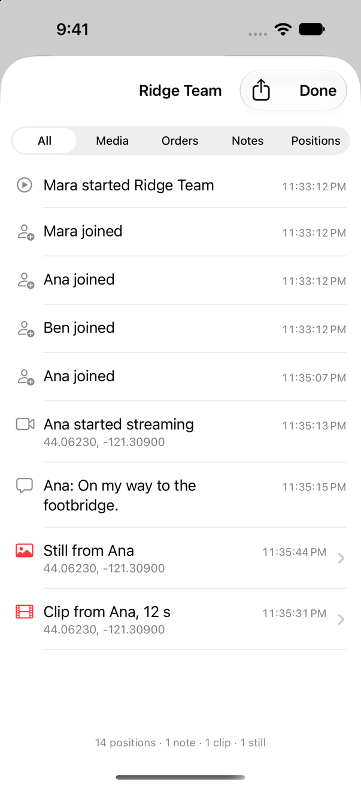

# The mission log

What happened in a squad, in time order, kept on the leader's device so the mission can be looked at afterwards.



Every squad a device leads gets a log. It starts when the squad starts, picks up again if the leader's app is restarted, and stays after the squad ends until the leader deletes it. A member's phone keeps no log.

## What goes in it

| Entry | When | What it carries |
| --- | --- | --- |
| `squadStarted`, `squadEnded` | The leader starts or ends the squad | The squad's name |
| `joined` | Someone joins | Who |
| `left`, `removed` | Someone leaves, or the leader removes them | Who, and the notice's words |
| `position` | Each position report, the leader's own included | Who, where, accuracy, which way they were facing |
| `order` | The leader sends an order | What and to whom, the place if it has one, the order's ID |
| `orderAnswer` | Someone answers | Who, Seen / Done / Can't, the order's ID |
| `orderCancelled` | The leader takes an order back | The order's ID |
| `note` | A field note, from anyone | Who, the words, where they were |
| `zoneArrival`, `zoneDeparture` | A monitored member crosses a zone boundary | Who, zone label, location, and zone ID |
| `streamStarted`, `streamStopped` | A phone starts or stops streaming | Who, where they were, the stream's ID |
| `clip` | A recording of a stream is closed | Who, where, how long, the stream's ID, **the file** |
| `still` | The leader snaps a picture from a stream | Who, where, the stream's ID, **the file** |

Positions are the time series: at the squad's update rate, one entry per report per person. Orders and their answers are tied together by the order's ID; streams and the clips and stills from them by the stream's ID.

The log is written by comparing the squad's state with what was last logged, each time anything changes, so nothing has to remember to log.

## On the device

One folder per squad, in the app's own storage:

```
missions/<squad id>/mission.json   the squad's name, when it started and ended
missions/<squad id>/log.jsonl      one JSON entry per line, in the order written
missions/<squad id>/media/         the clips (.mp4) and stills (.jpg) entries point to
```

An entry:

```json
{"id":"…","kind":"clip","time":1795149331000,"member":"…","name":"Ana","at":{"latitude":44.0623,"longitude":-121.309},"ref":"…","file":"clip-1795149331000.mp4","seconds":12.1}
```

| Field | |
| --- | --- |
| `id` | The entry's own ID |
| `time` | Milliseconds since 1970. For a clip, when the recording began, so sort by `time` to read the log in order |
| `kind` | One of the kinds above |
| `member`, `name` | Who it is about, and their name then, so the log reads without the roster |
| `at`, `accuracy`, `heading` | Where, how good the fix was in metres, and degrees clockwise from north |
| `text` | Words: an order, a note, an answer, a notice |
| `ref` | The order or stream this belongs to |
| `file` | A file in `media` |
| `seconds` | How long a clip runs |

Fields that don't apply are left out. A line that doesn't read is skipped by the app, not fatal.

## In the app

- **While leading:** the clipboard button on the squad screen opens the running log.
- **Afterwards:** *Mission logs* on the home screen lists every squad the device has led.
- The log can be narrowed to media, orders, notes or positions. A clip or still opens to play or view, and can be shared on its own.
- **Export** hands the whole mission, log and media, to the share sheet as one zip file.
- Swipe a mission in the list to delete it and everything it kept. The squad being led now can't be deleted.

## What it is not

- **Not a backup of the squad.** Restarting the leader's app still loses the orders and notes on screen; the log has them, but the app doesn't read them back in.
- **Not shared.** It is on the leader's device only. Nothing goes to a relay or to members.
- **Not sealed.** The files are protected by the device like the app's other files, and an export is a plain zip. Whoever gets the zip can read it.
- **Not complete for video.** Only what the leader chose to record or snap is kept; a stream that wasn't recorded leaves only its start and stop.

## Tested, and not

- In the simulator: a test leads a squad, has a phone stream, records and snaps, then sends an order, an answer, a note and a position, and checks each is in the log; that the clip plays and the still opens; that the log outlives the squad, exports as a zip, and deletes with its media.
- By hand in the simulator: recorded a 12-second clip and a still from a stand-in's stream and saw both in the log.
- **Not tested:** on real devices; a long mission (hours of positions); the share sheet's export on a device.
