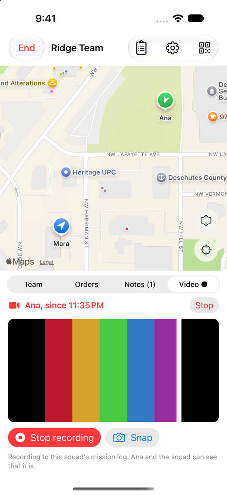

# Squad video, first cut

A member's phone streams its camera to the leader's device. This is the smallest version that is worth trying in the field, and it is deliberately narrow.

(The picture is from the simulator, which has no camera and sends a moving test pattern.)

## What it does

- **A phone streams to the leader's device, and only there.** No other member receives the pictures.
- **The camera starts only on a tap on that phone.** The leader can ask, with a *Stream video* order; being asked starts nothing.
- **One stream at a time.** A second phone is turned down and told who is streaming.
- **Everyone can see who is streaming.** It is in the squad's status; the streaming phone shows a red bar on every tab, with Stop on it.
- **Either end stops it:** the phone, or the leader from the Video panel.
- **Nothing is kept unless the leader records or snaps,** and the squad is told when they do. See [Keeping what was seen](#keeping-what-was-seen).
- **No sound.**

## Keeping what was seen

For looking back at a mission afterwards ([MISSION_LOG.md](MISSION_LOG.md)).

- **Record** saves the stream to a video file on the leader's device as it arrives. The frames go into the file as the phone sent them; nothing is encoded again. The file starts at the next key frame, so up to two seconds after the tap.
- **Snap** saves the picture on screen as a JPEG.
- Both go in the squad's mission log with who was streaming, when, and where that member was.
- **Everyone is shown.** The stream's entry in the squad's status carries `recording` and a count of `stills`, so the streaming phone's red bar says "and being recorded" and how many stills were kept, and the rest of the squad sees that the stream is being recorded. There is no way to record without that.
- Only the leader's device can record, and what it keeps stays on it until the leader exports or deletes it.
- A stream that ends closes its recording.
- A still is as coarse as the stream. For a sharp picture the phone has to take one and send it, which the app doesn't do yet.

## How the pictures travel

The phone encodes its camera as H.264 at about 300 kilobits a second, ten pictures a second, with a key frame every two seconds. Each picture goes to the leader's device as a mission message on the link the phone already has.

That choice does three things:

- **The stream is protected exactly as everything else on the link is.** On the local network that is the link's TLS; through a relay it is the sealing in [WIRE.md](WIRE.md) §9. A mesh node or a relay in between sees ciphertext. No new key and no new handshake.
- **It works through the relay as it is,** with no extra server.
- **The app needs no video library.** It uses the encoder and decoder that are part of iOS.

And it costs three things, which is why this is a first cut:

- **It shares the link with positions, orders and check fire.** A picture in flight delays whatever is behind it. At these sizes that is a fraction of a second on a good link and can be a second or more on a bad one.
- **It does not adapt.** The bit rate is fixed; on a link that can't carry it the stream stalls instead of getting coarser.
- **It is larger on the wire than it needs to be.** Messages are JSON, so a picture's bytes are written as base64: about a third more, so roughly 400 kilobits a second for a 300 kilobit stream.

The design this grew from (in the project's plan notes) uses WebRTC for the pictures, which adapts and travels beside the squad's link instead of on it. The control side here (asking, starting, who is streaming, stopping, the leader's limits) is written to stay as it is when the pictures move to WebRTC.

## The mission

`squadz.video`, version 1, in the core's `mission` envelope ([WIRE.md](WIRE.md) §6). The core's version does not change, and a device without it ignores it and is still a full member.

**Control messages** are JSON:

| `t` | Direction | Fields | Meaning |
| --- | --- | --- | --- |
| `start` | Member → leader | `stream` | This phone is starting stream `stream` (a UUID it made) |
| `stop` | Either way | `stream`, `why`? | The stream is over |
| `refused` | Leader → member | `stream`, `why` | Not now: someone else is streaming |

**A frame**, member → leader, is not JSON. The payload is:

| Bytes | |
| --- | --- |
| 1 | `01` |
| 16 | The stream's ID |
| 4 | The frame's count, big-endian |
| 1 | `01` for a key frame, else `00` |
| the rest | H.264, Annex B: each unit after `00 00 00 01`. A key frame starts with its parameter sets (SPS, PPS) |

A payload that starts with `{` is control; one that starts with `01` is a frame.

**In `status.missions`:** `{"streams": [{"id", "member", "since", "recording", "stills"}], "maxStreams": 1, "kbps": 300}`. `recording` is whether the leader's device is saving the stream; `stills` is how many pictures it has kept from it. Both may be absent, meaning no and none.

**The order kind** `squadz.video.stream` is the leader asking. A device that doesn't know it shows the order's text.

## What the leader's device does

- `start`: if nobody else is streaming, lists the stream and tells everyone (a new status). A phone that starts again replaces its own stream. Otherwise answers `refused`.
- A frame: shown only if it comes on the link of the member whose stream it names, and that stream is listed. Frames never pass through the squad's state and are not kept.
- `stop` from the streaming phone, or the leader stopping it: the stream is unlisted and everyone is told. The leader's stop also sends the phone a `stop`.
- A phone whose link drops, or that leaves or is removed, is no longer listed as streaming.

## Not in this cut

- Watching by anyone but the leader, and member to member.
- Camera nodes on a mesh (MediaMTX), a balloon's camera, and many viewers.
- WebRTC, adapting to the link, and sound.
- A limit that depends on how good the link is. At the far end of a mesh's range one stream can be most of what the link carries.
- Running alongside another mission. A squad runs one mission, and in Squadz this is it.

## Tested, and not

- `cd swift && swift test`: the mission's rules. One at a time, the leader's stop, a dropped phone, only the streaming phone's frames counting, everyone being told about recording and stills, and a device without the mission.
- The app's tests in the simulator: made-up pictures through the real encoder, into frames, and back to something a screen can show; and three app instances where one streams to the leader, a second is turned down, and the leader and the phone each stop it. The same test records a clip and takes a still, checks the clip plays and the still opens, and that both phones were shown the recording.
- By hand: a Mac stand-in streaming a test pattern to the app leading a squad in the simulator. The pattern showed, moving.
- On a real iPhone and iPad on one Wi-Fi network: the phone's camera showed on the iPad. Recording and stills have not been tried there yet.
- **Not tested:** a mesh, the relay with video on it, what it does to positions and orders on a slow link, and battery.
